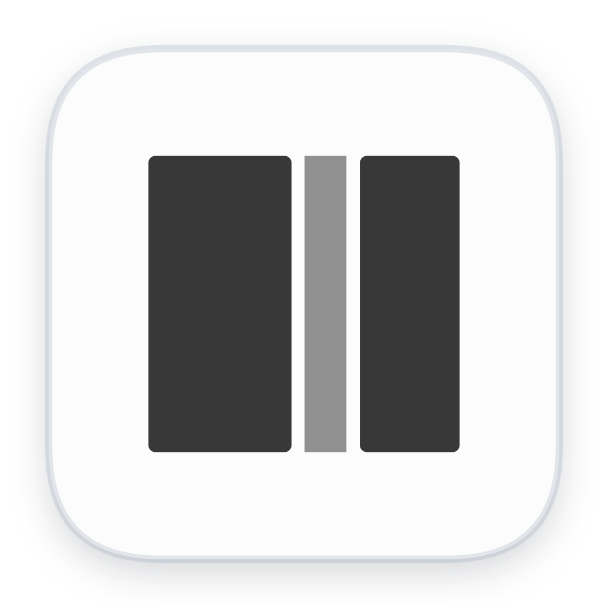

<p align="center">
  
</p>

<h1 align="center">Sela</h1>

<p align="center">
  <strong>A little space to remember.</strong><br />
  <a href="https://sela.akbarsaputrait.tech">Visit the Sela website</a>
  · macOS 14+
  · Designed with ADHD in mind
</p>

---

## Put the thought down. Come back when it matters.

Sela is a calm Mac reminder for thoughts that are important, just not for right now. Capture one, choose when it should return, and get back to what you were doing.

No planner to maintain. Sela is for the reminder you don't need to hold in your head—not another calendar or task manager.

## A lighter way to remember

- **Add a reminder from anywhere** with `⌘⇧Space`, or use the menu-bar icon.
- **Choose a quick timer or set a custom duration** when you want the reminder back.
- **Pick the kind of nudge that fits the moment:** a full-screen pause, a compact notch alert, or a macOS notification.
- **Change your mind without losing the reminder:** mark it done, snooze it, reschedule it, or leave it in Activities for later.
- **Keep your reminders on your Mac.** Sela has no account or analytics. Apple Reminders sync is not available yet.

### A few shortcuts

`⌘⇧Space` Add reminder · `⌘1–3` Timer presets · `⌘T` Custom timer · `⌘L` Open dashboard

## Get started

Sela requires macOS 14 or later and can be built for Apple Silicon or Intel Macs. To run it from source, install Bun and Rust, then:

```bash
bun install --frozen-lockfile
bun run tauri dev
```

Builds made without an Apple Developer account are ad-hoc signed, not notarized. If you share one, macOS may require a manual approval to open it. See [Updating Sela](docs/updating.md) for safe backup and update steps.

## Your reminders stay close

Reminders and settings live in a local database on your Mac. Sela cannot wake a sleeping or powered-off Mac, but overdue reminders are surfaced when Sela resumes or opens again. Native notifications follow macOS notification permissions and Focus settings.

For the implementation and data guarantees, see the [architecture notes](docs/architecture.md). For development, testing, and contribution guidelines, see [CONTRIBUTING.md](CONTRIBUTING.md).

## License

Sela is available under the [MIT License](LICENSE).
